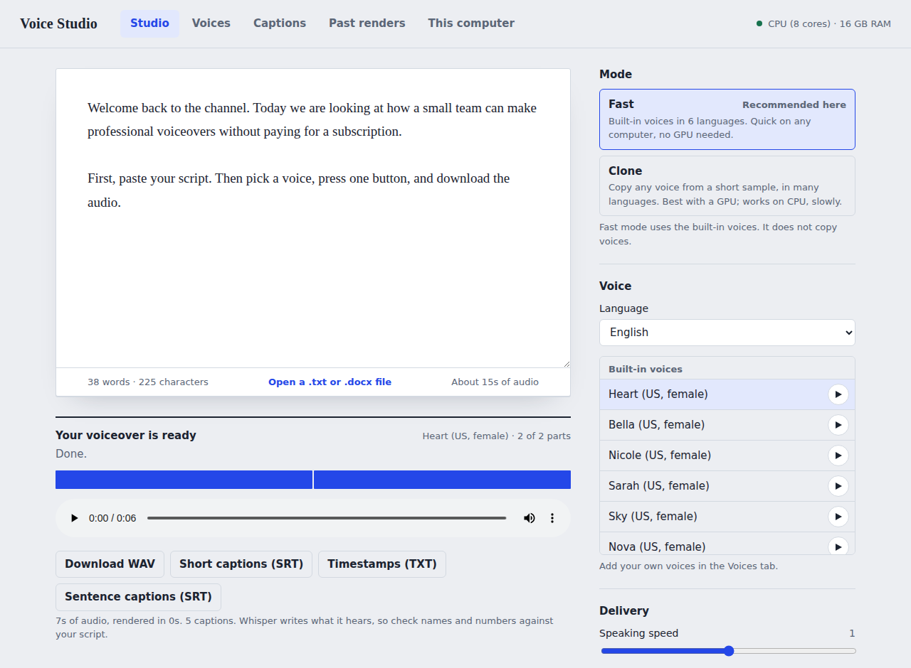

# Voice Studio

**Free voiceovers on your own computer.** Turn a script into spoken audio with no account, no per-minute fees, and nothing uploaded.
Built-in voices in six languages, optional voice cloning in 23 languages, and short captions for video editors.
Works on Windows, Mac and Linux, with or without a graphics card.

**[Download](https://github.com/myxenn0001-prog/voice-studio/releases/latest)** · **[Try it in your browser](https://myxenn0001-prog.github.io/voice-studio/try/)** · **[Website](https://myxenn0001-prog.github.io/voice-studio)**

Built by TechFlow so that anyone can make voiceovers without paying for a cloud service.

## Get it

| You use | Do this |
|---|---|
| **Windows** | Download `VoiceStudio-Setup.exe` from the [latest release](https://github.com/myxenn0001-prog/voice-studio/releases/latest) and run it. |
| **Mac** (Apple Silicon) | Download `VoiceStudio-macOS.dmg`, drag the app to Applications, then right-click it and choose Open the first time. |
| **Linux** | Download `VoiceStudio-Linux.AppImage`, make it executable (right-click, Properties, Allow executing), then double-click it. |
| **Just want to try it** | Use the [browser edition](https://myxenn0001-prog.github.io/voice-studio/try/). Nothing to install, but it has fewer features. |

The first time you open the app, a window shows a one-time setup that downloads the voice software. It needs internet and takes several minutes.
After that it opens in seconds and works offline.

Your computer may warn about a new program from a small publisher: on Windows choose **More info**, then **Run anyway**.

**Offline use.** The first-launch setup downloads everything Fast mode and Captions need, so after it finishes they work with no internet.
Voice cloning models are several GB, so they are optional: download them any time from **This computer > Use offline**, or they download the first time you use Clone mode.

### Other ways to install

- **winget (Windows):** `winget install TechFlow.VoiceStudio` (once the package is accepted).
- **Homebrew (Mac):** `brew install --cask myxenn0001-prog/tap/voice-studio` (once the tap is published).
- **Pinokio:** in [Pinokio](https://pinokio.computer), choose Discover, paste `https://github.com/myxenn0001-prog/voice-studio`, then press Install and Start.
- **From the source code:** see [Run it from source](#run-it-from-source).
- **Docker:** `./docker-start.sh` (Mac and Linux) or `docker-start.bat` (Windows). Docker on Mac and Windows cannot use the graphics card.

## What it does

- **Fast mode** uses the Kokoro voices: more than 40 built-in voices in English (US and UK), Spanish, French, Hindi, Italian and Portuguese. It is quick on an ordinary computer.
- **Clone mode** uses Chatterbox to copy a voice from a short recording, and speak it in 23 languages, including Arabic. It is slow without a graphics card.
- **Short captions** with Whisper: an SRT file in short-form style (one short line at a time) or standard subtitles, plus a timestamp list.
- **Scripts of any length:** rendered in parts with progress and a cancel button, with controls for pauses, speed and file type (WAV, FLAC or MP3).
- **Import** a `.txt`, `.md` or Word `.docx` file by dropping it on the script page.
- **A voice library:** keep your own voices beside the built-in ones.
- **Private:** your scripts, voices and audio stay on your computer. After setup it works offline.

| | Fast | Clone |
|---|---|---|
| Engine | Kokoro-82M (Apache-2.0) | Chatterbox (MIT) |
| Voices | 40+ built-in voices in 6 languages | Your own voices from a short sample, plus a default voice |
| Languages | English (US, UK), Spanish, French, Hindi, Italian, Portuguese | Arabic, Danish, German, Greek, English, Spanish, Finnish, French, Hebrew, Hindi, Italian, Japanese, Korean, Malay, Dutch, Norwegian, Polish, Portuguese, Russian, Swedish, Swahili, Turkish, Chinese |
| On a CPU | Quick | Slow, several times slower than real time |
| On a GPU | Very quick | Comfortable |

Quality is best in English. Other languages are less polished, and French has only one built-in voice, so listen to a preview first.
Whisper writes what it hears, not your script, so check names and numbers in captions.

### Is it as good as paid services such as ElevenLabs?

Not always. The best paid services are generally more polished and faster. Voice Studio's voices suit narration, explainers and drafts,
and it is free, private and works offline. Try a short script in both and judge for yourself.

## Using it

1. Open **Studio**, paste or drop in your script.
2. Choose a mode and a voice (the play button hears a preview).
3. Press **Render voiceover**, then download the audio. Tick **Also make short captions** if you want captions for your editor.

To clone a voice, open **Voices**, add a 5 to 30 second recording of one clear speaker, confirm you have permission, and render in Clone mode.
You can also drop audio files into the `data/voices` folder. The **Captions** tab makes captions for any audio or video file.

**Where things are saved:** your voices, renders and settings live in the `data` folder (for installed copies: `%LOCALAPPDATA%\VoiceStudio\data`
on Windows, `~/Library/Application Support/VoiceStudio/data` on Mac, `~/.local/share/voice-studio/data` on Linux). Back it up to keep your library.

## Run it from source

You need Python 3.10 to 3.12.

- Windows: double-click `run.bat`. Mac or Linux: run `./run.sh`.

The first run installs everything into a private `.venv` folder and adds a desktop icon, then opens the app at http://localhost:8000.
To update an existing copy, run `./run.sh --update` (Mac and Linux) or delete `.venv\.installed` and run `run.bat` again (Windows).

## Legal

Voice Studio is provided as is, with no warranty. On first launch it asks you to accept the [Terms of Use](TERMS_OF_USE.md). Also read the
[Privacy Notice](PRIVACY.md) (short version: the app collects nothing), the [Responsible use note](RESPONSIBLE_USE.md), the
[name and logo policy](TRADEMARKS.md), the [Code of Conduct](CODE_OF_CONDUCT.md) and the [third-party licenses](THIRD_PARTY_LICENSES.md).
This is not legal advice. The same pages are inside the app (they open offline) and on the website.

## Responsible use

Voice cloning can be misused. Only clone a voice that is yours or that belongs to someone who has agreed, do not use the audio to deceive people,
and say when audio is synthetic where it matters. Voice Studio asks you to confirm permission before adding a voice, and the cloning model
adds an inaudible watermark. Every file Voice Studio makes is also marked as AI-generated in its metadata, and for voices other than Clone mode the app applies the same watermark when it is installed. Please do not remove the marks. Read [RESPONSIBLE_USE.md](RESPONSIBLE_USE.md).

## Contributing

Bug reports, language testing, translations, documentation and code are all welcome. See [CONTRIBUTING.md](CONTRIBUTING.md).
The tests run in seconds without any models: `VOICESTUDIO_MOCK=1 python -m pytest tests`.
To add another voice engine, copy `app/engines/kokoro_engine.py`; it then appears as a new mode with no other changes.

## Support the project

Voice Studio is free and always will be. If it saves you money and you would like to help keep it going, star the repository, tell a friend,
or use the Sponsor button on the repository page if there is one.

## License

Voice Studio is released under the [Apache License 2.0](LICENSE). See [NOTICE](NOTICE) and [THIRD_PARTY_LICENSES.md](THIRD_PARTY_LICENSES.md)
for the projects it builds on. The voice models are downloaded on first use under their own licenses.

Copyright 2026 TechFlow.
